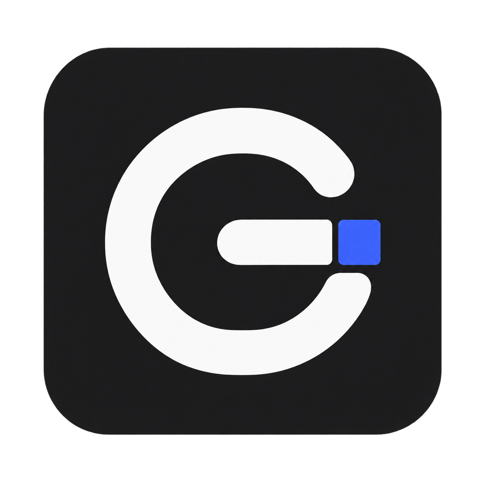

<div align="center">
  
  <h1>GAgent: A Self-Evolving Agent in Your Pocket</h1>
  <p><strong>See your screen. Use your tools. Remember what works.</strong></p>
  <p>🧠 GenericAgent core · 🤖 Android &amp; iOS · 👁️ Local vision · 🖱️ ESP32-S3 BLE HID · 🌐 Connected devices</p>
  <p><a href="README.zh-CN.md">简体中文</a> · <a href="#start">Android Quick Start</a> · <a href="#ios-start">iOS Quick Start</a> · <a href="docs/IOS_GETTING_STARTED.md">iOS Guide</a> · <a href="docs/CONFIGURATION.md">Capabilities</a> · <a href="docs/README.md">Docs</a></p>
  <p><a href="https://gaagent.ai/">Website</a> · <a href="https://app.gaagent.ai/">GA Mobile APK</a> · <a href="https://github.com/lsdefine/GenericAgent">GenericAgent</a> · <a href="https://androidbench.gaagent.ai/">AndroidBench</a></p>
</div>

[Apache-2.0](LICENSE) · Android 11+ (`arm64-v8a`) &amp; iOS 17+ (`arm64` + ESP32-S3 BLE HID) · [Privacy](PRIVACY.md) · [Development since June 13, 2026](docs/HISTORY.md)

**GAgent brings GenericAgent's minimal, self-evolving autonomous-agent design to both Android and iOS.**
Give it a goal: it can observe the screen, write and execute Python on the device, work with local files, connect to your computer via PC Link, and turn verified experience into reusable procedures. The agent loop and runtime run directly on your phone; you bring your own model endpoint.

<a id="start"></a>
## 🤖 Android: Install → configure → run

**You need:** an **arm64 Android 11+ phone**, internet access, and your own model
provider's **API URL, key and model ID**. Python and the phone tools are inside the
APK. No computer, root, Shizuku, Docker or separate Python installation is needed
for ordinary use.

1. **📦 Get the open-source APK.** Download **GAgent-release.apk** and `SHA256SUMS`
   from the latest [prerelease](https://github.com/shenhao-stu/GAgent/releases) (no
   sign-in needed) and check the hash. Newer builds are CI artifacts from
   [Android builds](https://github.com/shenhao-stu/GAgent/actions/workflows/android.yml?query=branch%3Amain)
   (sign in, pick a green **main** run, extract **GAgent-android-…**). [Download, checksums and installation →](docs/GETTING_STARTED.md#download)
2. **🔑 Add your model.** Open **Settings → Providers & Models → Add provider**.
   Select the matching protocol and enter the URL, key and **Default model ID**;
   tap **Save**. Fetching a model list is optional. Leave Proxy empty unless needed.
3. **📱 Enable phone use.** Open **Settings → Accessibility** and enable GAgent in
   Android's settings. Turn on **Always-on floating window** and allow overlay
   access to keep task progress visible. [Permission walkthrough →](docs/GETTING_STARTED.md#permissions)
4. **✅ Check one task.** First send “Reply OK”; then try “Open Settings without
   changing anything.” For image understanding, use the [vision setup prompt](docs/CONFIGURATION.md#models),
   then ask it to describe that screen. Text, tool use and vision are separate checks.

**Prefer your agent to handle Android setup?** Paste this into **GenericAgent, Codex or Claude Code**:

```text
Help me install and configure the open-source GAgent using this guide:
https://github.com/shenhao-stu/GAgent/blob/main/docs/INSTALL_WITH_AGENT.md
Inspect my OS, existing tools and chosen Android device. Prefer a verified APK;
resolve only the dependencies needed for that path. Preserve existing apps/data,
keep credentials out of chat/logs, and guide me through manual Android permissions.
Verify text, a harmless tool action and vision separately; report anything untested.
```

[📖 Android installation](docs/GETTING_STARTED.md) · [🤖 Agent setup guide](docs/INSTALL_WITH_AGENT.md) ·
[🔧 Build from source](docs/BUILD.md) · [🩺 Troubleshooting](docs/TROUBLESHOOTING.md)

<a id="ios-start"></a>
## 🍎 iOS (IOSAgent): Flash → sign → pair → run

Because iOS sandboxes third-party apps from reading other apps' screens or synthesizing system-wide touches, **GAgent on iOS** combines **on-device CPython 3.13 + Apple ReplayKit Screen Broadcast + Apple Vision OCR** with a tiny, pure-MIT **ESP32-S3 Bluetooth LE HID bridge** (~$5 dev board powered by any USB charger or power bank — no cable attached to the iPhone during everyday use).

### Minimal Atomic Toolset (First-Principles Design)

GAgent iOS keeps the smallest possible atomic tool surface — **9 tools total**:
- **6 local core tools**: `code_run` (embedded Python 3.13 + `rubicon-objc` + local UNIX shell utilities), `file_read`, `file_write`, `file_patch`, `ask_user`, `start_long_term_update`
- **3 device & cross-device primitives**:
  - `screen`: on-demand ReplayKit frame capture + on-device Apple Vision OCR + numbered Set-of-Mark elements + `frame_id` freshness verification
  - `hid`: encrypted BLE GATT commands to ESP32-S3 (`tap`, `double_tap`, `long_press`, `swipe`, `drag`, `type`, `key`, `scroll`, `button`, `stage_text`, `status`, `stop`)
  - `pc_link`: optional WebSocket pairing with a desktop GenericAgent Hub

### iOS Quick Start

**You need:** an **iPhone running iOS 17+** (iOS 18+ recommended for enhanced bilingual OCR; iOS 26+ enables system background continuation), a **Mac with Xcode 16+** and `xcodegen` (`brew install xcodegen`), an **ESP32-S3 board** (e.g., ESP32-S3-DevKitC-1 N8R8), and an **HTTPS model provider API key**.

1. **⚡ Flash the ESP32-S3 HID bridge (one-time).** Install `arduino-cli`, `esp32:esp32` (3.3.x), and `NimBLE-Arduino`, connect the ESP32-S3 to your Mac via USB, and run:
   ```bash
   bash ios/firmware/flash.sh
   ```
   Once flashed, you can power the ESP32-S3 from any 5V USB wall adapter or power bank.
2. **📲 Build, sign & install GAgent on your iPhone.** Connect your iPhone to your Mac via USB (with Developer Mode enabled), find your Apple Team ID in **Xcode → Settings → Accounts**, and run:
   ```bash
   APPLE_TEAM_ID=YOUR_TEAM_ID bash ios/deploy_device.sh
   ```
   > **Free Apple ID (Personal Team) tip:** Free Personal Teams allow at most 3 App IDs per week. If signing the extra Dynamic Island widget extension hits that limit, run `WITHOUT_WIDGETS=1 APPLE_TEAM_ID=YOUR_TEAM_ID bash ios/deploy_device.sh` (re-run every ~7 days when free certificates expire; local app data is preserved).
3. **🔑 Configure an HTTPS model provider.** Open **Settings → Providers & Models → Add provider**, enter an **`https://` API Base URL**, API Key, and **Default model ID** (a vision-capable model such as GPT-4.1 / Claude Sonnet / Gemini / Qwen-VL is recommended for GUI tasks), tap **Save**, and accept the explicit data-sharing disclosure for that provider.
4. **🖱️ Complete the 4-step iPhone Control Setup.** Open **Settings → iPhone Control (`iPhone 操作`)**, enable **Allow GAgent to operate**, then follow the 4 guided cards:
   - **Step 1 — Connect ESP32:** Scan and pair `ESP32 Agent XXXX` inside GAgent (encrypted BLE bonding).
   - **Step 2 — Enable Wireless Mouse/Keyboard:** Open **iPhone Settings → Accessibility → Touch → AssistiveTouch → ON** (required by iOS so Bluetooth mice can tap the screen), and pair `ESP32 Agent XXXX` under **Settings → Bluetooth** (or AssistiveTouch → Devices → Bluetooth Devices).
   - **Step 3 — Share Screen:** Tap **Start Broadcast** (`ReplayBroadcastControl`) to start the on-device ReplayKit Screen Broadcast to GAgent.
   - **Step 4 — Calibrate Pointer:** Keep GAgent in the foreground without touching the screen and tap **Start Auto Calibration** (`开始自动校准`). GAgent automatically probes landings across the screen and verifies < 1.5% click error.

### iOS Usage & Safety Guidelines

- **Dynamic Island, Live Activities & In-Place Answers:** While a task runs across apps, GAgent shows live step progress on the Dynamic Island and Lock Screen. When `ask_user` asks a question, you can pick an option or type a reply directly from the notification / Live Activity.
- **Human Takeover for Sensitive Actions:** Never hand passwords, Apple Pay / payment confirmations, 2FA codes, Face ID prompts, or system permission alerts to the model. Pause / take over from the Dynamic Island or GAgent UI, complete the sensitive step yourself, and resume when ready.
- **Instant Hardware Stop:** Tapping **Stop** in GAgent, on the Dynamic Island, or stopping Screen Broadcast in iOS Control Center immediately cancels in-flight commands, invalidates stale `frame_id` observations, and sends an out-of-band `release` to the ESP32-S3 so no button or key remains held.
- **HTTPS-Only & Local Sandbox:** On iOS, `mykey.py` is parsed strictly as static data (never executed as code), outbound model requests enforce HTTPS with TLS verification and no redirects, and `code_run` / file tools are confined to `temp/`, `memory/`, and `uploads/`.

[📘 Full iOS Getting Started Guide](docs/IOS_GETTING_STARTED.md) · [🏗️ iOS Architecture & Developer Docs](ios/README.md) · [🔒 Privacy Policy](PRIVACY.md)

---

> **Open-source preview.** Releases are prereleases, not a stable channel; CI
> artifacts require GitHub sign-in and expire after 14 days. Preserve existing apps and data: release
> (`io.github.shenhaostu.gagent`) and debug (`io.github.shenhaostu.gagent.debug`) have
> separate identities. [app.gaagent.ai](https://app.gaagent.ai/) distributes the
> separate official mobile edition. [Native dependency migration](docs/DEPENDENCY_SECURITY.md)
> and broader device acceptance remain open.

The foundation is [GenericAgent's **~3K-line seed core**](https://github.com/lsdefine/GenericAgent):
a compact execution loop, a small tool vocabulary and layered memory. Android and iOS
capabilities sit around that core. The figure describes the upstream seed, **not
the entire mobile codebase**. [Core, memory and counting scope →](docs/CORE_AND_MEMORY.md)

## ✨ What GAgent brings together

| Capability | What you can do |
| --- | --- |
| 🧠 **Memory that becomes a tool** | Keep a small index, recall relevant facts and procedures on demand, and reuse verified solutions across sessions on both Android and iOS. |
| 🍎 **iOS ReplayKit + ESP32-S3 BLE HID** | Capture frames on demand via ReplayKit + Apple Vision OCR and execute calibrated relative-pointer gestures over encrypted BLE HID — zero jailbreak, zero private APIs, pure MIT firmware. |
| 👁️ **Android Local OCR + optional YOLOv8n** | Read text and locate 21 classes of Android UI controls locally; ask an image-capable model when semantic understanding is needed. [Install YOLO](docs/OPTIONAL_YOLO.md). |
| 📱 **Android Self-ADB, without Shizuku** | Pair with Android's own wireless debugging to gain authorized shell capabilities. Ordinary GUI use needs accessibility, not ADB. |
| 🪟 **Android Offscreen apps & web tasks** | Move supported apps to a virtual display, or run a separate background WebView on Android. |
| 🔗 **PC Link** | Pair your Android phone or iPhone with desktop GenericAgent Hubs for cross-device sessions, model selection, and streaming replies. |
| 🎙️ **On-device voice input** | Hold to speak, release to transcribe, or slide up to cancel — Apple `SFSpeechRecognizer` (`requiresOnDeviceRecognition`) on iOS and `sherpa-onnx` on Android. |
| 🛠️ **APK Factory (Android)** | Describe a small app, generate its project, then submit, track and fetch its APK through your configured build service. |

**Local tools are ready to configure; hosted integrations are opt-in.** PC Link has no default relay: enter the relay you run or are authorized to use, or tap the explicit public GenericAgent relay preset and review its note, then scan the computer QR to pair. Voice input is local; APK Factory requires your own build service. [All setup steps](docs/CONFIGURATION.md) · [Component boundaries](docs/OFFICIAL_MODULES.md)

## 🧠 A small core, useful memory, less repeated context

GAgent carries the **same GenericAgent lineage and core architecture**, with
platform adapters for Android and iOS:

**Observe → act → verify → save the useful procedure → recall it when needed.**

- **Recall selectively.** A short memory index points to facts, procedures and
  scripts; the full library need not be inserted into every model request.
- **Keep working state compact.** Checkpoints, short summaries and context trimming
  preserve relevant progress while reducing repeated history.
- **Grow capabilities through use.** Verified procedures and local Python tools can
  become part of the next task. Review learned material; a failed attempt is not a fact.

[Implementation and measurement](docs/CORE_AND_MEMORY.md)

## 🧪 Practical things to try

| Try asking | Setup / recorded result |
| --- | --- |
| “Find videos on my topic, sort by most played, and list titles and creators.” | Simple-sort passes and a later Meizu timeout are recorded; combined date/duration filters remained partial. |
| “Read the driving time and distance; don't start navigation.” | Recorded Amap route readback passed with matching history available. |
| “Browse McDonald's in WeChat using GUI only; stop before submitting and at any login.” | Reached meal selection and phone login; no confirmed cart, checkout or payment. |
| “Open Settings on my iPhone, check Wi-Fi and Bluetooth status, and change nothing.” | Verify ReplayKit observation + calibrated ESP32-S3 BLE HID navigation on iOS. |
| “Read a test folder on my paired computer and summarize its filenames.” | Recipe: configured PC Link and an authorized peer; start read-only. |

See [cases and evidence](docs/CASES.md), [iOS Getting Started](docs/IOS_GETTING_STARTED.md),
and [AndroidBench](https://androidbench.gaagent.ai/).

## 🗺️ Roadmap & News

| Date · UTC+8 | Milestone |
| --- | --- |
| **2026-11-25** | Open-source **IOSAgent** (`ios/`): ReplayKit + Apple Vision OCR, pure-MIT ESP32-S3 BLE HID firmware, 1-tap auto pointer calibration, Dynamic Island / Live Activity Presence UI, and merged `main` runtime fixes |
| **2026-10-23** | Apache-2.0 Android source preview; opt-in services, visual-only WeChat, network/overlay/geometry fixes and public setup guides |
| **2026-08-06 → 08-13** | PC Link/P2P client and recorded GAnet integration |
| **2026-07-15 → 07-18** | Scheduling and native notification triggers |
| **2026-06-27 → 07-03** | Local-change preservation, self-ADB, browser control and virtual-display adapters |
| **2026-06-24** | Android-specific YOLOv8n with 21 UI classes replaces the earlier detector |
| **2026-06-16** | Streaming voice input |
| **2026-06-13** | Earliest verifiable Android implementation and same-day build/device report |

[History and source references](docs/HISTORY.md) · [Changelog](CHANGELOG.md) · [Roadmap](docs/ROADMAP.md)

## 🤝 Build with us

[Android Build](docs/BUILD.md) · [iOS Build & Architecture](ios/README.md) · [Architecture](docs/ARCHITECTURE.md) · [Development](docs/DEVELOPMENT.md) · [Testing](docs/TESTING.md) · [Contributing](CONTRIBUTING.md) · [PR checklist](.github/PULL_REQUEST_TEMPLATE.md)

Keep the core small, make variable inputs explicit, preserve invariants in testable
functions, and isolate device/network effects. English and Chinese contributions
are welcome. [Security](SECURITY.md) · [Privacy](PRIVACY.md)

## 📄 License & lineage

Project-owned code: [Apache-2.0](LICENSE). Built on **Liang Jiaqing and contributors'
GenericAgent / GAndroid**; iOS `BoardKit` and ESP32-S3 HID firmware (`ios/BoardKit/`,
`ios/firmware/`) are derived from **Henry Yuan's [ESP32 iPhone Agent](https://github.com/onehumanbeing/esp32-iphone-agent)** (MIT License).
Attribution remains in [NOTICE](NOTICE), [ios/BoardKit/NOTICE](ios/BoardKit/NOTICE), and [ios/firmware/NOTICE](ios/firmware/NOTICE).
[Third-party libraries, fonts and models](THIRD_PARTY.md) retain their own terms.
All GPL AirPlay components and YOLO detector weights are excluded from the repository.

[Website](https://gaagent.ai/) · [GA Mobile](https://app.gaagent.ai/) · [GenericAgent](https://github.com/lsdefine/GenericAgent) · [AndroidBench](https://androidbench.gaagent.ai/) · [Logo](docs/assets/README.md)
